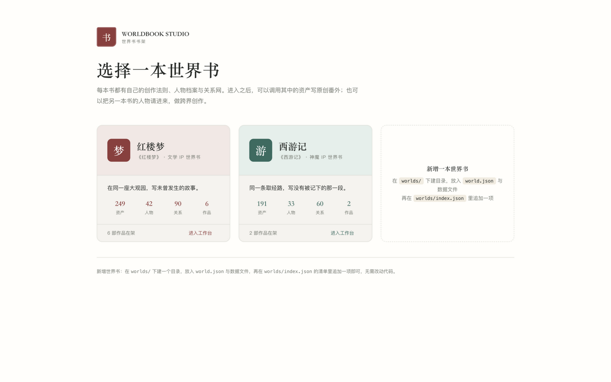
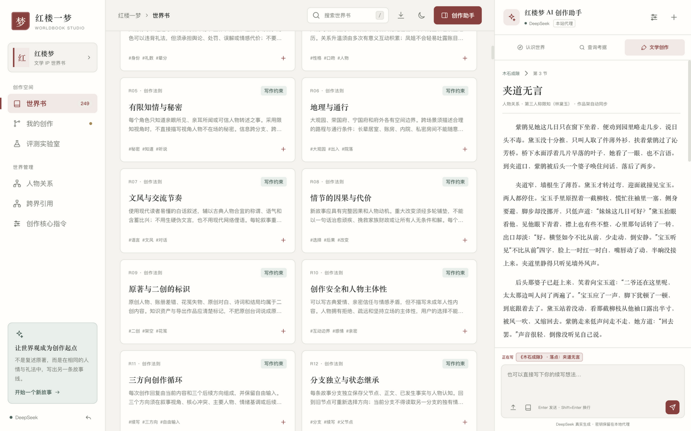
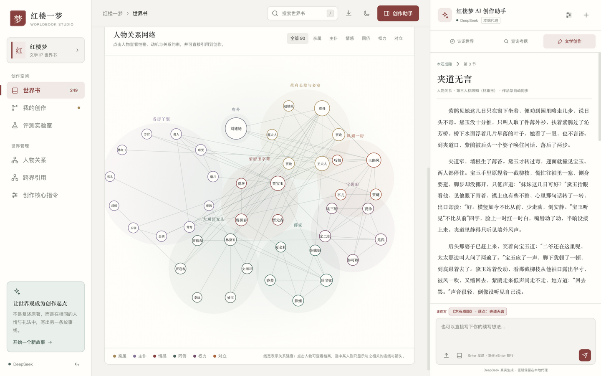
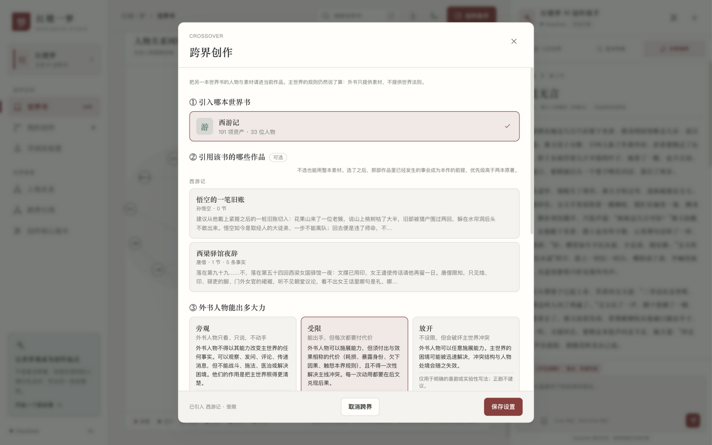
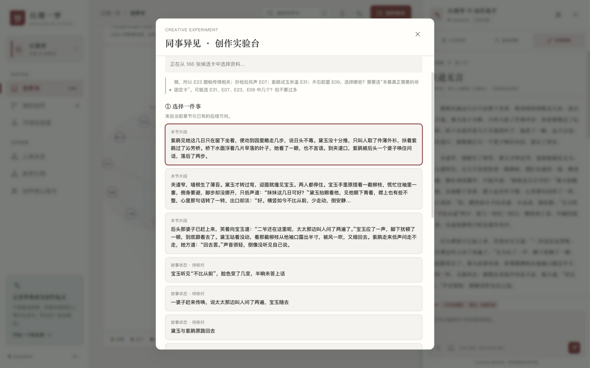
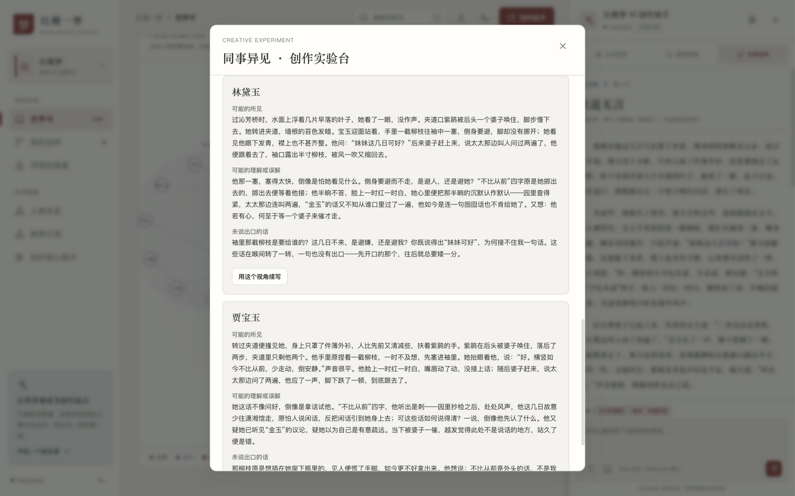
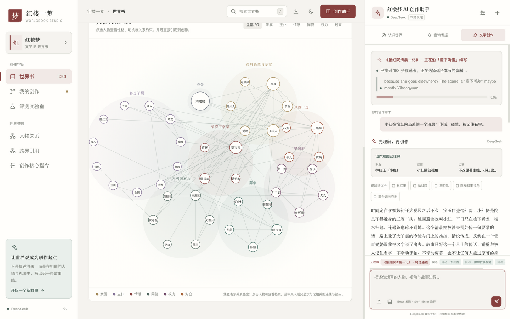
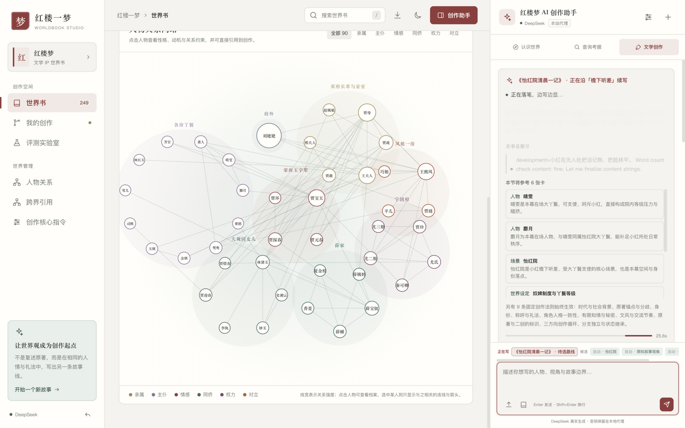

# Worldbook Studio · 多世界书 AI 文学二创工作台

把一部 IP 的世界观拆成**可检索、可注入、可复用**的知识资产，再让模型在这套资产上持续写新故事。

同一套代码跑两本世界书：**《红楼梦》**与**《西游记》**。每本书有自己的创作法则、人物档案、关系网、预设主角与评测基准；作品架与主题偏好互相隔离，通过同一套注册表同时装载，因此可以**跨书引用**——在红楼梦的作品里请进西游记的人物，或反过来。

核心链路：**世界书资产 → 理解创作需求 → 三条差异化路线 → 用户选择 → 分支续写 → 创作质量评测**。

| 世界书 | 资产 | 人物 | 关系 | 世界设定 | 创作法则 |
|---|---|---|---|---|---|
| 红楼梦 | 249 | 42 | 90 | 24 | 12 |
| 西游记 | 191 | 33 | 60 | 20 | 12 |

技术上是**零第三方依赖**的单进程应用：Python 3 标准库提供静态服务与两个 API，前端是原生 HTML/CSS/JS，作品存 SQLite。接任何 OpenAI 兼容接口（默认 DeepSeek）。

> **这里没有在线 Demo。** 本仓库是源码，不附带托管实例——任何在文档里出现的地址都是**你自己机器**上的。按「快速开始」跑起来即可得到 `http://localhost:8080`。
>
> 之所以不提供公网演示：这个应用没有鉴权、没有限流、没有多用户，而且每次生成都消耗**你配置的**模型额度。想要公网访问，请自行加带鉴权的反向代理，见「自托管 → 安全边界」。

## 界面速览

| | |
|---|---|
|  |  |
| _书架：每本世界书独立入口_ | _工作台：249 项资产即查即引_ |
|  |  |
| _90 组关系的力导向关系网_ | _跨界创作：选书 → 力量档 → 通达方式_ |
|  |  |
| _同事异见：真实 reasoning 思考带流动中_ | _同一件事，不同人物眼里生出不同故事_ |
|  |  |
| _续写时的真实思考过程带_ | _边写边显，段落渐次浮现_ |

生成过程全程可见：**真实 reasoning 思考带 → 选卡依据 → 段落流式浮现 → 正文按字墨雾渐显落位**。

---

## 快速开始

**前置要求**：Python 3.9+、一部可用的 DeepSeek API Key。无需 Node、无需 npm、无需构建。

```bash
git clone https://github.com/Baitlo/WorldBooks.git
cd WorldBooks

# 配置密钥（此文件已在 .gitignore）
cp config.example.json config.local.json   # 若仓库无此模板，直接新建，见下
```

`config.local.json` 最小内容：

```json
{
  "api_key": "sk-你的密钥",
  "model": "deepseek-flash",
  "reasoning_effort": "low",
  "base_url": "https://api.deepseek.com"
}
```

启动：

```bash
python3 server.py
```

打开 <http://localhost:8080>。无参数进**书架**，选一本进工作台；带参数可直接进某本：<http://localhost:8080/?world=honglou>、<http://localhost:8080/?world=xiyou>。

验证服务正常：

```bash
curl -s http://localhost:8080/api/health
```

返回 `ok: true` 且 `model` 与思考强度正确即可开始。想换端口用 `PORT=8090 python3 server.py`。

**没有 API Key 也能看**：页面右上角齿轮 → 连接方式选「离线演示」，可用本地预设数据浏览资产、关系图与评测基准，只是不调用模型。

---

## 目录

- [快速开始](#快速开始)
- [界面速览](#界面速览)
- [多世界书架构](#多世界书架构)
  - [加一本新世界书](#加一本新世界书)
  - [Studio 契约](#studio-契约)
- [跨界创作](#跨界创作)
  - [四步设置](#四步设置)
  - [引用既有作品](#引用既有作品)
  - [六条仲裁条款](#六条仲裁条款)
  - [跨书资产 ID](#跨书资产-id)
- [技术栈与架构](#技术栈与架构)
- [文件职责](#文件职责)
- [维护索引：改 X 动哪里](#维护索引改-x-动哪里)
  - [改内容](#改内容)
  - [改行为](#改行为)
  - [容易踩的坑](#容易踩的坑)
- [世界书资料](#世界书资料)
  - [《西游记》（191 项）](#西游记191-项)
  - [《红楼梦》（249 项）](#红楼梦249-项)
  - [角色覆盖](#角色覆盖)
  - [人物关系](#人物关系)
  - [来源与标注](#来源与标注)
- [运行时机制](#运行时机制)
  - [三层渐进式披露](#三层渐进式披露)
  - [上下文注入与两阶段选卡](#上下文注入与两阶段选卡)
  - [任务卡](#任务卡)
  - [思考强度与输出预算](#思考强度与输出预算)
  - [故事状态快照](#故事状态快照)
- [自托管](#自托管)
  - [局域网内多设备访问](#局域网内多设备访问)
  - [开机常驻（macOS）](#开机常驻macos)
  - [用容器跑](#用容器跑可选未随仓库提供)
  - [安全边界](#安全边界)
  - [密钥配置](#密钥配置)
- [共享作品库](#共享作品库)
- [测试](#测试)
  - [跨界测试覆盖什么](#跨界测试覆盖什么)
  - [两条端到端手工验证](#两条端到端手工验证)
- [已知限制](#已知限制)
- [许可](#许可)

---

## 多世界书架构

世界书是**目录**，不是代码。数据放在 `worlds/<id>/` 下，清单在 `worlds/index.json`。

```text
worlds/
├── index.json          世界书清单（唯一要手动维护的文件）
├── honglou/
│   ├── world.json      品牌、配色、脚本顺序、全局变量名
│   └── data-*.js       6 个数据文件
└── xiyou/
    ├── world.json
    └── data-xiyou*.js  5 个数据文件
```

装载分两步：

1. **服务端注入**：`server.py` 读清单，把当前世界的 `<script>` 序列替换进 `index.html` 的 `<!--WORLD_SCRIPTS-->` 占位。前端不做异步加载——`data-lore` 依赖 `data.js` 已构造的对象，顺序被打乱会静默取空。
2. **`registry.js` 建注册表**：把所有世界的数据同时收进 `WB_REGISTRY`，再把当前那本挂到 `WORLDBOOK_DATA` / `STUDIO_DATA` 上供旧代码读取。

为什么需要注册表而不是简单的「换全局变量」：跨界引用要求同时持有多本世界书的数据，单靠 swap 做不到。

入口分流：无 `?world=` 参数进书架（`shelf.html`），带参数进工作台（`index.html`）。当前世界记在 `localStorage['worldbook-world']`。

### 加一本新世界书

三步，**不改任何 JS**：

1. 建目录 `worlds/<id>/`，放入数据文件（结构对齐现有任一本）。
2. 写 `world.json`：

```json
{
  "id": "sanguo",
  "name": "三国演义",
  "book": "《三国演义》",
  "seal": "汉",
  "cover": "汉",
  "subtitle": "历史 IP 世界书",
  "tagline": "……",
  "palette": "#3a5a8c",
  "paletteSoft": "#e6ecf6",
  "storageKey": "sanguo-worldbook-studio-v2",
  "globals": { "data": "SANGUO_WORLDBOOK", "studio": "SANGUO_STUDIO" },
  "scripts": ["data.js", "studio-data.js"]
}
```

   关键：`globals` 里写的是数据文件挂到 `window` 上的变量名，`scripts` 是加载顺序。两个数据文件都必须存在且用这两个名字，否则注册表会跳过这本书。

3. 在 `worlds/index.json` 的 `worlds` 数组里追加 `"sanguo"`。

`server.py` 的白名单已按目录前缀放行，`shelf.html` 自动出现新卡片。

**两本书各自隔离的四样东西**：

| 项 | 隔离方式 |
|---|---|
| 作品库 | `localStorage` 键含世界 ID；服务端 `library` 表以 `world` 为主键 |
| 主题偏好 | `worldbook-theme-<world>` |
| 预设主角与 Benchmark | `STUDIO.protagonists` / `STUDIO.benchmark` |
| 关系图分组 | `STUDIO.relationGroups`，`center: true` 标出固定在圆心的簇 |

### Studio 契约

新增第三本世界书时，你只需要提供一份同构的 `STUDIO` 对象。`ai.js` 与 `app.js` 会读取这些字段，**缺字段会回落到红楼梦的默认值**，不会崩：

| 字段 | 用途 | 缺省行为 |
|---|---|---|
| `systemPrompt` | 主提示词 | 必填 |
| `canonAuthor` / `bookName` | 导出声明与评审提示里的署名 | `曹雪芹` / `《红楼梦》` |
| `coreRules` | 每节必带的法则 ID | 红楼梦的 9 条 |
| `protagonistAliases` | 检索时识别人物别称 | `{}` |
| `graphAliases` | 关系图里的简称归一 | `{}` |
| `relationGroups` | 关系图分簇（`center` 标记圆心簇） | 必填否则图空 |
| `defaultBrief` | 任务卡默认值 | 红楼梦的世情番外 |
| `benchmark` | Benchmark A 的三人组与提示词 | 取 `protagonists` 前三 |
| `titleCues` / `titleFallback` | 自由续写时自动起标题 | `一程另记` |
| `ui` | 品牌、hero、导出文件名等界面文案 | 逐项回落到红楼梦措辞 |
| `generic` | 用户点名无预设路线的人物时的兜底三路线 | 通用模板 |

`ui` 里 `{name}` / `{prompt}` 占位符会被 `genericProfile` 替换成实际人名与需求。

---

## 跨界创作

在一本世界书的作品里，引入另一本的人物与素材。核心约束只有一条，但它是硬约束：

> **主世界的法则说了算。外书提供素材，不提供世界法则。**

原因是两本书的创作法则互不兼容——红楼梦 R01 明令「不得随意增加架空仙术」，西游记整个建立在神通与法宝之上。两套法则同时注入，模型会收到矛盾指令，典型症状是在大观园里写出祥云缭绕。所以：

| 项 | 来源 | 是否注入 |
|---|---|---|
| 创作法则（怎么写） | 仅主世界 | 独占 |
| 世界事实（人物、场景、事件、设定） | 主世界 + 外书 | 外书卡标注 `引自《西游记》` |
| 文学风格卡 | 主世界 + 外书 | 最安全，天然可移植 |

### 四步设置

侧边栏「跨界引用」：

1. **引入哪本世界书**：从 `WORLDBOOK_CATALOG` 里选。换书会清空已生成的通达选项与引用作品，因为两者都是针对特定书写的。
2. **引用该书的哪些作品**（可选）：见下节。不选也能用整本素材。
3. **外书人物能出多大力**：三档，写死在 `bridge.js`，不交给模型。
   - `旁观`：外书人物不得改变主世界任何事实，只能观察、发问、传递消息。
   - `受限`（默认）：能出手，但须付出相称代价，且不得一次性解决主线冲突。
   - `放开`：不设限。界面上明确警告会破坏主世界冲突。
4. **两界如何通达**：点按钮让 AI 生成三个选项，作者挑一个。**这是硬门禁**——没选通达方式，保存会被拦住。没有它，模型只能硬凑两界关系。

AI 生成的三个选项差异必须落在**代价结构**上，不能是同一设定的三种措辞。实测样例：毫毛石影（每次通行烧一根毫毛、半日失一项神通）、袈裟影渡（通行者替园中人承一段情债，唐僧忘一段取经旧事）、钉耙地沟（园中一处花木枯三日、一人无故替病）。

### 引用既有作品

「引用一本书」和「引用你写过的一部作品」是两件事：

| | 引用什么 | 例 |
|---|---|---|
| 世界书引用 | 该书的**原著素材** | 借孙悟空这个人、花果山这个地方 |
| 作品引用 | 你**自己作品里已经成立的事实** | 在你的番外里，平儿查出了那笔账、谁和谁的关系变了 |

跨世界读作品架只能走服务端（本机 `localStorage` 只有当前那本），所以打开面板时异步拉取。

注入时取该作品**当前路径末端节点的故事状态**：已发生事实、人物认知（谁在场、谁知情、谁被瞒着）、未解决线索，外加该作品用过的资产 ID 与创作前提。作品还没有正文时退回创作前提。

**事实优先级**（写进提示词，从高到低）：

```
当前作品的已发生事实 > 引用作品的既有事实 > 主世界原著 > 外书原著
```

并声明「以上是这位作者自己的设定，不是任何一本书的原著」——否则模型会把作者写过的原创情节当成原著，或反过来被原著覆盖。

引用作品用过的卡会进候选池并带「引用作品用过」加成，且**不受分类配额限制**（作者点名的意图不该被 cap 挤掉），但仍受总字数预算约束。

实测一例：引用《西梁驿馆夜辞》后，提示词带上了 5 条已发生事实与这份知情边界——「悟空、八戒在厢房，未参与，不知写帖之事；女王未出场，帖尚未递到」。

### 六条仲裁条款

写在 `bridge.js` 的 `arbitration()` 里，**不由任何一本世界书提供**——每本书的作者都会本能地偏袒自己那本，让它来写仲裁必然偏心。

1. 法则归属：主世界的物理、社会与礼法规则优先。
2. 出场来源：外书人物只能经已声明的通达方式进入，不得凭空出现。
3. 能力约束：按所选档位。
4. 身份与称谓：按主世界尊卑称谓，保留自身口吻。
5. 冲突归属：**主世界的核心矛盾必须由主世界的人物与手段了结。**
6. 出处标注：叙事中应让读者可辨外书人物与物件的来处。

实测效果：让悟空帮忙填贾府的亏空，模型自己让悟空说「变银子使不得，坏了你们的运数，俺也得折神通」，转而查欠账、追赃——在场、有性格、能推动，但不越权解决。

### 跨书资产 ID

两本书的资产 ID 会撞（`C01` 在红楼梦是贾宝玉，在西游是孙悟空）。规则：

- **主世界资产保持裸 ID**（`C01`），完全兼容旧作品、`ENTRY_MAP` 与全部测试。
- **外书资产必须带前缀**（`xiyou:C01`）。
- 内部查表用 `qualify()` 得到唯一键，对外输出用 `normalize()`。

`ai.js` 导出了 `qualify` / `normalize` / `entryOf` / `worldOfId` / `resolveCharacter` 供调试与测试。

---

## 技术栈与架构

**无构建、无 npm 依赖、无 CDN。** 修改后刷新页面即生效（静态资源带版本参数）。

| 层 | 技术 | 说明 |
|---|---|---|
| 前端 | 原生 HTML/CSS/JS | 三栏工作台，无框架 |
| 服务端 | Python 3 标准库 | `http.server` + `urllib`，零第三方依赖 |
| 存储 | SQLite | 作品库与 100 个历史版本 |
| 模型 | DeepSeek API | 经服务端代理，密钥不出服务端 |

```text
浏览器 ──GET 静态资源──┐
       ──POST /api/chat──┤  server.py  ──HTTPS──▶ api.deepseek.com
       ──GET/PUT /api/library?world=<id>──┘      │
                                                  └──▶ storage/worldbook.sqlite3
```

三个接口：

| 方法 | 路径 | 用途 |
|---|---|---|
| GET | `/api/health` | 通道状态、模型、思考强度、密钥来源 |
| POST | `/api/chat` | 转发 DeepSeek，密钥在服务端注入 |
| GET / PUT | `/api/library?world=<id>` | 读取 / 保存**该世界**的作品库（PUT 带版本号检查） |

`world` 缺失或不是已知值时回落到 `honglou`，所以旧链接 `?v=23` 这类地址仍能读到红楼梦的作品。

**前端脚本加载顺序有依赖，不可调换**（见 `index.html` 末尾）：

```text
worlds/<id>/*.js     按 world.json 的 scripts 数组注入（经 <!--WORLD_SCRIPTS--> 占位）
  → registry.js      等全部世界数据就绪后才建注册表
  → ai.js
  → bridge.js
  → app.js
```

各世界内部，数据文件之间也有顺序：`data-lore` / `data-deep` 直接修改 `data.js` 已构造的对象，`data-relations` 整体替换 `relationship_edges`。西游的四个数据文件同理，最后一个 `data-xiyou-world.js` 补事件、场景与原创素材。

`registry.js` **必须在所有世界数据之后、`ai.js` 之前**执行，否则 `ai.js` 读到的是未就绪或错本的全局变量。

---

## 文件职责

```text
WorldBooks/
├── index.html                   工作台骨架、三栏布局、所有弹窗、<!--WORLD_SCRIPTS--> 占位
├── shelf.html                   书架页：每本世界书一张卡片
├── shelf.js                     书架渲染（读注册表 + /api/shelf）
├── styles.css                   宣纸/墨青/绛红视觉系统、暗色主题、跨界面板、响应式
├── registry.js                  注册表：同时装载所有世界，把当前那本挂到全局
├── ai.js                        多世界客户端：提示词、三层披露、检索、校验、四项能力
├── bridge.js                    跨界：三个力量档、六条仲裁、通达选项生成
├── app.js                       界面状态、渲染、分支树、关系图、作品库同步、导出
├── server.py                    静态服务 + /api/chat + /api/library + /api/shelf
│
├── worlds/
│   ├── index.json               世界书清单（唯一手动维护的文件）
│   ├── honglou/
│   │   ├── world.json           品牌、配色、脚本顺序、全局变量名
│   │   ├── data.js              红楼梦基础：法则、角色、场景、事件、风格
│   │   ├── data-lore.js         角色扩充：判词、首次出场、原著事件、结局线索
│   │   ├── data-deep.js         角色深读：形象、性格层次、语言例句、名场面
│   │   ├── data-world.js        世界设定 24 条
│   │   ├── data-relations.js    人物关系 90 条
│   │   └── studio-data.js       红楼梦 Studio 配置
│   └── xiyou/
│       ├── world.json
│       ├── data-xiyou.js                12 法则 + 20 世界设定
│       ├── data-xiyou-figures.js        角色 C01–C16
│       ├── data-xiyou-figures2.js       角色 C17–C33 + 60 条关系
│       ├── data-xiyou-world.js          事件 30、场景 22、原创素材 8
│       └── studio-xiyou.js              西游记 Studio 配置
│
├── assets/                      16 张清·孙温《绘全本红楼梦》配图（公有领域，仅红楼梦）
├── docs/screenshots/            README 引用的界面截图
├── storage/                     SQLite 库、服务日志（已 gitignore）
├── tests/                       5 个 Node 测试 + 1 个 Python 测试，见「测试」
├── config.example.json          配置模板，可安全提交
├── config.local.json            你的真实密钥（已 gitignore，切勿外传）
├── LICENSE                      个人使用许可，使用前请读
└── .gitignore
```

---

## 维护索引：改 X 动哪里

### 改内容

下表默认指红楼梦。西游的对应文件见上一节「文件职责」，字段结构完全相同。

| 想改什么 | 改哪里 | 注意 |
|---|---|---|
| 加角色 | `data-lore.js` 的 `NEW_CHARACTERS` 数组（西游：`data-xiyou-figures*.js`） | `id` 接着 C43 往下排；`source`/`target` 用**全名**，不能写别名 |
| 给角色加判词、原著事件 | `data-lore.js` 的 `ENRICH` 对象 | 按 `C01` 这样的 id 追加 |
| 给角色加形象、语言例句 | `data-deep.js` 的 `DEEP` 对象 | 会拼接进 `content`，卡片正文因此变厚 |
| 加世界设定 | `data-world.js` 的 `WORLDBUILDING` 数组 | 必须带 `usage` 与 `constraint` 两个字段 |
| 加人物关系 | `data-relations.js` 的 `EDGES` 数组 | `type` 限六类；`intensity` 为 1–5；端点必须是角色全名 |
| 改场景 / 事件 | `data.js` | 场景可有 `image: "assets/xxx.jpg"` |
| 改创作法则 | `data.js` 的 `rules` | 与世界设定是两回事，见下 |
| 改文学风格 | `studio-data.js` 的 `styles` | 加载时会写入 `data.styles` |
| 加世界书 | 见「多世界书架构」的 Studio 契约 | 新增文件要同步改 `index.html` 与 `PUBLIC_FILES` |

**关系图分簇（西游必看）**：`STUDIO.relationGroups` 的 `members` 用人物全名。任何没写进分组的角色会被自动收进「其他人物」簇，不会从图上消失，但会挤在一起。加人物后建议顺手补进对应簇。

改完数据后**必须确认没有悬空端点**（见「测试」中的校验脚本）。

### 改行为

| 想改什么 | 改哪里 |
|---|---|
| 系统提示词 / 创作原则 | `studio-data.js` 的 `systemPrompt` |
| 续写要求、JSON schema | `ai.js` 的 `continueBranch` |
| 选卡打分权重、分类配额 | `ai.js` 的 `retrieveAssets` 与 `CATEGORY_CAP` |
| 前情摘要窗口（默认 4 节） | `ai.js` 的 `buildChronicle` / `pathContext` |
| 注入预算（默认 2600 字） | `ai.js` 的 `retrieveAssets` 调用参数 |
| 每节必带的法则 | `STUDIO.coreRules`（红楼梦 9 条、西游 9 条） |
| 任务卡默认值 | `STUDIO.defaultBrief`（西游是神魔番外 / 420 字 / 诙谐而有威） |
| 输出预算 | `ai.js` 的 `TOKEN_BUDGETS` |
| 硬校验 / 软提示 | `ai.js` 的 `checkAgainstBrief`、`continueBranch` 内 `validate` |
| 关系图分簇、配色 | `STUDIO.relationGroups`（分簇）、`app.js` 的 `EDGE_TYPES`（六类配色） |
| 界面文案与布局 | `index.html` + `app.js` 的 `render*` 函数 |
| 静态白名单 | `server.py` 的 `PUBLIC_FILES`（根目录文件）；`worlds/` 下按前缀自动放行 |
| 力量档文案与约束 | `bridge.js` 的 `POWER_LEVELS` |
| 仲裁条款 | `bridge.js` 的 `arbitration()` |
| 通达选项的生成提示 | `bridge.js` 的 `proposeBridges()` |
| 书架上显示什么 | `shelf.js` 的 `card()` |
| API 超时 | `server.py` 的 `TIMEOUT`（客户端为 `ai.js` 中 `330000` 毫秒） |

### 容易踩的坑

1. **新增前端文件要改两处**：`index.html` 加 `<script>`，`server.py` 的 `PUBLIC_FILES` 加文件名。漏了后者会 404，页面白屏。
2. **静态资源带版本参数**（`?v=43`）。改完 JS/CSS 若浏览器仍用旧文件，把 `index.html` 里的版本号统一 +1。
3. **`registry.js` 的位置不能动**。它必须排在所有世界的数据文件之后、`ai.js` 之前；排错会让 `ai.js` 拿到未就绪或错本的全局变量，症状是提示词与资产对不上却完全不报错。
4. **别在 `app.js` / `ai.js` 里写死某一本书的内容**。人物简称、法则 ID、Benchmark 人物、界面文案都已外置到 `STUDIO`，写死会让另一本书串味。判据：在两本书下各跑一遍页面，搜不到对方的专名。
5. **SVG 的 `font-size` 属性压不过 CSS 的 `font` 简写**。关系图给大簇缩字号用的是内联 `style`，改回呈现属性会失效。

---

## 世界书资料

两本书合计 **440 项资产**。世界设定与创作法则分开维护——前者是「世界是什么」，后者是「该怎么写」。

### 《西游记》（191 项）

基准为**明刊世德堂本一百回**。不混用 86 版电视剧的造型、台词与战斗设计，这条已写进 R09 与默认任务卡的禁止项。

| 类目 | 数量 | 内容 | 文件 |
|---|---|---|---|
| 角色档案 | 33 | 取经队伍 5 人、灵山佛门 2 人、天庭 7 人、仙真与龙族 3 人、妖王 13 人、人间 3 人；含形象、性格层次、语言例句、名场面、写作注意 | `data-xiyou-figures*.js` |
| 人物关系 | 60 | 六类标签，覆盖全部 33 人，无悬空端点 | `data-xiyou-figures2.js` |
| 场景档案 | 22 | 花果山、灵台方寸山、凌霄宝殿、兜率宫、五行山、火焰山、狮驼岭、灵山等 | `data-xiyou-world.js` |
| 剧情事件 | 38 | 30 条原著事件（石猴出世→封果位）+ 8 条原创素材 | `data-xiyou-world.js` |
| 世界设定 | 20 | 三界位阶、天庭官僚、灵山果位、妖怪后台、八十一难、变化边界、法宝克制、紧箍咒、人间诸国、幽冥生死簿、时间尺度、队伍秩序、称谓语料、章回体、诙谐分寸、佛道张力、原创妖怪设计、取经政治、长生代价、二创空间 | `data-xiyou.js` |
| 创作法则 | 12 | 与红楼梦同构，但落到神魔语境的约束 | `data-xiyou.js` |
| 文学风格 | 6 | 章回调、韵文分寸、斗法技术化、妖怪视角、诙谐分寸、偈语留白 | `studio-xiyou.js` |

**三位预设主角**刻意错开视角：孙悟空（旧部情义 / 向师父讨假 / 识破来历）、唐僧（西游女儿国驿馆一夜）、白骨精（无后台者的算计与恐惧）。这是「同一套世界书写出三种故事」最直接的演示。

**关系图分 6 簇**：取经队伍（圆心）、灵山佛门、天庭、仙真与龙族、妖王与洞府（13 人）、人间。

妖王簇人数最多，所以环半径按人数缩放（13 人约 254），簇内字号降到 13px；其余小簇维持 16px。

### 《红楼梦》（249 项）

| 类目 | 数量 | 内容 | 文件 |
|---|---|---|---|
| 角色档案 | 42 | 身份、性格、动机、口吻、边界 + 形象、性格层次、语言例句、名场面、原著事件、判词、结局线索、写作注意 | `data.js`+`data-lore.js`+`data-deep.js` |
| 人物关系 | 90 | 类型、强度、关系描述、改编边界 | `data-relations.js` |
| 场景档案 | 28 | 空间、可发生事件、通行约束、常见人物、配图 | `data.js` |
| 剧情事件 | 47 | 38 条原著编年 + 9 条二创素材 | `data.js` |
| 世界设定 | 24 | 世系、爵位、财政、礼法、婚姻嫡庶、奴婢、科举、司法、宗教、节庆、饮食医药、器物、空间、诗社、谶语、版本、命名、通行、时间线、称谓、衰败逻辑、二创误区 | `data-world.js` |
| 创作法则 | 12 | 限知视角、人格一致性、知情边界、分支独立、三方向循环等 | `data.js` |
| 文学风格 | 6 | 限知叙事、古典白话、潜台词、诗词意象、物件驱动、群像复调 | `studio-data.js` |

### 角色覆盖

- **正册十二钗**：黛玉、宝钗、元春、探春、湘云、妙玉、迎春、惜春、凤姐、巧姐、李纨、秦可卿
- **副册／又副册及以下**：香菱、晴雯、袭人、鸳鸯、麝月、金钏、玉钏、司棋、莺儿、紫鹃、平儿、小红、芳官
- **男主与老爷**：宝玉、贾琏、贾珍、贾政、贾赦、贾环、薛蟠
- **长辈与妾室**：贾母、王夫人、邢夫人、赵姨娘、薛姨妈、尤氏
- **外人与边缘**：刘姥姥、尤二姐、尤三姐、夏金桂

### 人物关系

六类标签，90 条覆盖全部 42 人，无悬空端点：

| 类型 | 条数 | 说明 |
|---|---|---|
| 亲属 `kin` | 37 | 血缘与姻亲，含嫡庶、继室 |
| 同侪 `peer` | 14 | 诗友、姐妹、同房丫鬟 |
| 主仆 `serve` | 12 | 各房主子与贴身人 |
| 对立 `feud` | 11 | 明确冲突，含决裂与迫害 |
| 权力 `power` | 9 | 授权、提拔、施舍、制衡 |
| 情感 `love` | 7 | 木石前盟、金玉之说、通房 |

关系图按家族分 8 簇（荣府玉字辈为圆心 / 长辈 / 凤姐一房 / 宁国府 / 薛家 / 园中女儿 / 各房丫鬟 / 府外）。因 42 人 90 边同屏必然拥挤：

- 默认总览，节点大小按连接度；簇的环半径与字号按人数自适应
- 簇间做一次排斥松弛，消除叠压
- **点击人物即聚焦**，只显示该人与一度关系；再点一次打开档案
- 可按关系类型筛选；「退出聚焦」恢复总览

> 曾经的 bug：筛选值为 `all` 时被当成人名，整图降到 16% 不透明度。现在 `activeName` 会先排除 `all` 与六个关系类型。

### 来源与标注

判词、曲词、护官符、原文语句引自《红楼梦》第五回等章节（**公有领域**），已核对原文。其余为据前八十回整理的创作资料。

**需要区分三类来源**：原著事实（前八十回）、续书情节（后四十回，程高本）、本项目的整理与判断。`data-world.js` 的 W17、W24 专门说明这条边界。

配图为清·孙温《绘全本红楼梦》，公有领域，弹窗内已标注。

---

## 运行时机制

### 三层渐进式披露

选卡曾把 198 张非人物卡的全摘要（约 7.6k 字）一次性铺给模型，每生成一节都付一次。现在分三层：

| 层 | 内容 | 何时注入 | 实测成本（单本） |
|---|---|---|---|
| L0 索引 | `C01=贾宝玉` 一行 | 永远 | 1,530 字 |
| L1 摘要 | 一句 60 字 | 本地检索命中的前 16 张 | 约 340 字 |
| L2 全文 | 整张卡 | 模型选中后从本地取 | 零额外调用 |

**压缩率 80%**（7,597 → 1,530 字），且不增加往返次数。L2 不需要再调模型：全文一直在 `ENTRY_INDEX` 里。

跨书时外书**只给索引不给摘要**，逼模型按名字点名；索引也更短。

### 上下文注入与两阶段选卡

每次续写的上下文由五部分组成，在 `ai.js` 组装：

| 组成 | 规则 |
|---|---|
| 世界前提 | 创作起点，始终注入 |
| 前情摘要 | 超出最近 4 节的旧节点压成「人物 + 推进」事实账本，抽取式压缩，不额外调模型 |
| 最近正文 | 最近 4 节逐字，每节最多 420 字 |
| 创作法则 | 固定注入 9 条核心法则全文（`CORE_RULES`） |
| 关联资产 | 两阶段选卡，人物检索预算与最终注入预算各 2600 字 |

**两阶段选卡**：先本地检索人物候选（主角 / 本幕方向 / 最近正文提及 / 关系网一跳 / 前情遗留），同时把场景、人物关系、世界设定、事件、风格等非人物卡目录交给模型，由模型按任务卡与分支状态选本幕相关卡。程序核验候选 ID 后才注入。

- 固定卡与主角卡始终优先，不受模型选择影响
- 模型选卡超预算会列出未注入 ID；固定卡超预算则停止并提示，不静默丢失
- 选卡失败显示错误，**不会静默退回预设选卡**
- 局部人物候选受分类配额限制

等待面板随真实步骤更新。模型一次返回完整选卡结果，卡片依次出现是展示动画，非流式选卡；进度条只表示等待中，不代表百分比。

### 任务卡

每项目一张，注入提示词最前面。**篇幅与禁止项可程序检查，其余语义约束依赖模型遵循**：

| 字段 | 作用 |
|---|---|
| 体裁 | 世情日常番外 / 人物小传 / 群像片段 |
| 叙事人称 | 第三人称限知 / 第一人称 / 全知 |
| 每节目标字数 | 120–2000，偏离 ±35% 记为可复核问题 |
| 目标读者 | 影响用语与解释密度 |
| 基调 | 含蓄克制 / 清峻 / 低回 |
| 必须保留 | 不得违背的原著事实，逐条列出 |
| 明确禁止 | 正文含此完整文字时判失败重写；不识别同义表达 |

**硬失败（触发重写）**：正文为空、不含主角（第一人称允许「我」）、命中禁止项字面文字。
**软提示（记录不改写）**：字数偏离、剔除元信息段落。

元信息指模型自行附加的「原著/原创说明」「本节小结」——会污染后续上下文格式，直接丢弃并在明细报告段数。

编辑入口：助手正文里的「任务卡」一行 → 调整。

### 思考强度与输出预算

默认 `low`，可在 `config.local.json` 的 `reasoning_effort`、环境变量 `DEEPSEEK_EFFORT` 或页面设置中调整。

实测（`deepseek-flash`）：

| 档位 | reasoning tokens | 耗时 |
|---|---|---|
| `low`（默认） | 2578 | 19.5s |
| `high`（平台默认） | 3970–4602 | 29.9–34.0s |
| `max` | 6000（撞上限） | 45.7s |

**reasoning token 与正文共用 `max_tokens`。** 上限太低会让思考吃光预算、正文为空（`finish_reason=length`）。平台上限 393216，当前取值：

| 用途 | max_tokens |
|---|---|
| 续写 `continue` | 32000 |
| 新建规划 `plan` | 20000 |
| 六维评审 `evaluate` | 20000 |
| 考据 `research` | 16000 |
| 兜底 `default` | 20000 |

这是**上限不是计费量**，按实际生成结算。实测复杂规划在 `low` 档仅用 2807 token。代理层另有 200000 硬上限。

截断会被显式识别并报「输出被 N token 上限截断（其中思考约 M）」，标记为不可重试——避免盲目重试再失败。

### 故事状态快照

正文后保存独立的分支状态：已发生事实、人物与知情、未解决线索。下一节仅继承父节点状态。状态由模型整理，**可能有遗漏或误判**，可在正文下展开核对。

- 旧节点无状态时沿用路径正文，不虚构历史快照
- 重写上游节点后，后代标记为需更新，须从最早受影响节点逐节重写

---

## 自托管

这是一个**单文件服务**：不需要数据库服务器、不需要 Node、不需要反向代理就能跑。默认只监听 `127.0.0.1`，安全边界靠你显式打开。

### 局域网内多设备访问

> 这一节讲的是**方法**。下面的 `192.168.x.x` 只是示例占位，不是任何真实可访问的地址；你自己的那个由命令查出来。

想让手机或同网段的另一台电脑打开，先让服务监听所有网卡：

```bash
HOST=0.0.0.0 python3 server.py
```

再查本机在当前网络里的地址：

```bash
# macOS
ipconfig getifaddr en0
# Linux
hostname -I | awk '{print $1}'
```

命令会返回一个私有网段地址，其他设备访问 `http://<你查到的地址>:8080` 即可。

这个地址**属于你自己的网络**，每台机器、每次换网都会变，也无法从公网访问。它是私有网段（`10.x`、`172.16–31.x`、`192.168.x`）地址，公网上的任何人都不可能连上——这正是它安全的原因，也是它不能写进文档给别人的原因。

排障顺序：

```bash
lsof -nP -i :8080        # 应显示 *:8080；若显示 127.0.0.1:8080 说明没设 HOST
curl -s http://localhost:8080/api/health
```

仍打不开时依次检查：手机与电脑是否同一网段、系统防火墙是否放行 Python、路由器是否开了 AP 隔离。

### 开机常驻（macOS）

可选。用 LaunchAgent 让服务在登录后自动启动并在崩溃后重启：

```bash
cat > ~/Library/LaunchAgents/com.example.worldbooks.plist <<'PLIST'
<?xml version="1.0" encoding="UTF-8"?>
<!DOCTYPE plist PUBLIC "-//Apple//DTD PLIST 1.0//EN" "http://www.apple.com/DTDs/PropertyList-1.0.dtd">
<plist version="1.0"><dict>
  <key>Label</key><string>com.example.worldbooks</string>
  <key>ProgramArguments</key>
  <array>
    <string>/usr/bin/python3</string>
    <string>/绝对路径/WorldBooks/server.py</string>
  </array>
  <key>EnvironmentVariables</key>
  <dict><key>HOST</key><string>0.0.0.0</string></dict>
  <key>WorkingDirectory</key><string>/绝对路径/WorldBooks</string>
  <key>RunAtLoad</key><true/>
  <key>KeepAlive</key><true/>
  <key>StandardOutPath</key><string>/绝对路径/WorldBooks/storage/server.log</string>
  <key>StandardErrorPath</key><string>/绝对路径/WorldBooks/storage/server.err.log</string>
</dict></plist>
PLIST

launchctl bootstrap gui/$(id -u) ~/Library/LaunchAgents/com.example.worldbooks.plist
```

把 `/绝对路径/WorldBooks` 换成 `pwd` 的输出。之后：

```bash
launchctl print gui/$(id -u)/com.example.worldbooks   # 查看状态
launchctl kickstart -k gui/$(id -u)/com.example.worldbooks   # 改完 server.py 后重启
launchctl bootout gui/$(id -u)/com.example.worldbooks  # 停止
```

Linux 用 systemd user unit 等价替换；容器化部署见下节提示。

给 systemd 的一个最小 unit（`~/.config/systemd/user/worldbooks.service`）：

```ini
[Unit]
Description=Worldbook Studio
After=network.target

[Service]
WorkingDirectory=%h/WorldBooks
Environment=HOST=0.0.0.0
ExecStart=/usr/bin/python3 %h/WorldBooks/server.py
Restart=on-failure

[Install]
WantedBy=default.target
```

之后 `systemctl --user daemon-reload && systemctl --user enable --now worldbooks`。

**只改前端（HTML/CSS/JS）不需要重启服务**，刷新页面即可；改 `server.py` 需要重启。

### 用容器跑（可选，未随仓库提供）

仓库不含 Dockerfile，因为服务只依赖 Python 标准库。若你需要容器化，一个能用的最小起点：

```dockerfile
FROM python:3.12-slim
WORKDIR /app
COPY . .
ENV HOST=0.0.0.0 PORT=8080
EXPOSE 8080
CMD ["python3", "server.py"]
```

注意两点：必须挂载 `storage/`（否则容器重启丢作品库），`config.local.json` 建议用只读挂载注入而不是打进镜像。这份 Dockerfile 只是一个起点，未随版本做过完整验证，请自行确认。

### 安全边界

| 变量 | 默认 | 说明 |
|---|---|---|
| `HOST` | `127.0.0.1` | 设 `0.0.0.0` 才对外开放 |
| `PORT` | `8080` | 端口 |
| `ALLOWED_ORIGINS` | 空 | 额外允许的跨源来源，逗号分隔 |
| `WORLDBOOK_DB_PATH` | `storage/worldbook.sqlite3` | 作品库位置 |

已内建的防护：

- **静态白名单**：只放行 `PUBLIC_FILES` 里的根目录文件与 `assets/`、`worlds/` 前缀。`config.local.json`、`server.py`、`README.md`、`storage/` 一律 404。
- **路径穿越拦截**：百分号解码后、规范化前拒绝 `..`。
- **同源校验**：`/api/chat` 与 `/api/library` 的 `Origin` 必须匹配 `Host`，外部站点拿不到 403。
- **密钥不出服务端**：浏览器只与 `/api/chat` 通信，上游鉴权头由 `server.py` 添加。

**没有内置鉴权、没有限流、没有多用户。** 因此：

- ✅ 可以在**可信局域网**（家里、自己团队内网）里给几台设备用
- ⚠️ 想放到公网，**必须**自己在前面加一层带鉴权的反向代理（Nginx + Basic Auth / OAuth2 Proxy / Cloudflare Access），并配置 HTTPS
- ❌ 不要直接把 `HOST=0.0.0.0` 的服务端口映射到公网——那等于把你的模型额度公开给所有人

关于「公网地址」的一个常见误解：你在文档、截图或群里看到的 `192.168.x.x` / `10.x.x.x` / `172.16–31.x.x` 都是 RFC 1918 私有地址，只在**你自己的局域网内**可路由，公网上的机器永远连不上。所以本仓库的文档只写 `localhost`，把「怎么查你自己的局域网地址」写成命令，而不是写死一个地址——写死的那个对任何人都没用。

### 密钥配置

优先级：

1. `config.local.json` 的 `api_key`（**以此为准**）
2. 环境变量 `DEEPSEEK_API_KEY`（仅当配置文件无密钥时启用）

两者同时存在且不同时，`/api/health` 返回 `env_shadowed: true`，启动日志会告警。这是个容易踩的坑：配置文件静默压过环境变量，改环境变量不生效。

其他可选变量：`DEEPSEEK_MODEL`、`DEEPSEEK_EFFORT`、`DEEPSEEK_BASE_URL`。

页面右上角齿轮可切模型（`deepseek-flash` / `deepseek-v4-pro`）、思考强度、连接方式（自动 / 只走代理 / 浏览器直连 / 离线演示）。

`config.local.json` 已在 `.gitignore`。**提交前务必确认它没被 `git add -f` 加进去。**

---

## 共享作品库

作品存 `storage/worldbook.sqlite3`，不通过 HTTP 提供，不入 Git。

**按世界分表**：`library` 与 `library_history` 都以 `world` 作为主键的一部分，两本书的版本号各自计数。`PUT /api/library?world=xiyou` 不会影响红楼梦的 revision。

**旧库自动迁移**：启动时若探测到旧版的 `library(id=1)` 单行结构，会把整表改名后搬进 `honglou` 再删旧表。历史版本同样按此迁移。所以升级后红楼梦的作品与历史都在，西游从空库开始。

- 多设备访问同一服务即读写同一份库
- 首次打开新版页面时，该浏览器的旧 localStorage 作品会合并进共享库；同 ID 内容不同则保留副本
- **不同浏览器、`localhost` 与局域网 IP 的旧存档彼此独立，需分别打开一次完成迁移**
- 切换世界不会迁移另一本的本地存档——每本各自合并

**版本检查**：`PUT /api/library` 携带 revision，不匹配返回 409。后提交者不会覆盖服务器内容——按提示先导出本机未同步 JSON，刷新后导入。

手动清空某一本的库（会丢该世界全部作品，慎用）：

```bash
python3 - <<'EOF'
import sqlite3
db = sqlite3.connect("storage/worldbook.sqlite3")
db.execute("DELETE FROM library WHERE world='xiyou'")
db.execute("DELETE FROM library_history WHERE world='xiyou'")
db.commit()
EOF
```

SQLite 保留最近 100 个历史版本，但**不能代替异机备份**。作品架提供完整 JSON 备份/导入；「导出故事」是阅读用 Markdown。

---

## 测试

无 npm 依赖，直接跑：

```bash
# Python：存储、并发、冲突、同源（标准库 unittest，无需 pytest）
python3 -m unittest tests/test_storage.py -v

# Node：五个前端/逻辑测试，无需安装任何包
node tests/library_sync.test.cjs
node tests/perspectives.test.cjs
node tests/two_stage.test.cjs
node tests/perspective_picker.test.cjs
node tests/cross_world.test.cjs     # 跨界：40 条断言
```

五套 Node 测试的主数据是**红楼梦**，西游的覆盖靠 `cross_world` 里的「反向跨界」一组和文末的双世界校验脚本兜底。

### 跨界测试覆盖什么

`tests/cross_world.test.cjs` 共 **40 条**，八层：

| 层 | 断言要点 |
|---|---|
| 命名空间 | `C01` 在两本书分别是贾宝玉与孙悟空；裸 ID 归一化后仍是裸 ID；`worldOfId` 判归属；非法前缀不崩 |
| 力量档 | 三档齐全；未知档回落「受限」而不是「放开」 |
| 仲裁 | 六条齐全；放开档写明冲突会失效；无通达方式时 `bridgeBlock` 为空 |
| 跨书检索 | 不开跨界绝不出现外书卡；开了但没提到也不硬塞；主世界排在前；外书卡带「引自」出处 |
| 选卡提示 | 外书只给索引不给摘要；固定法则不进候选目录；跨书与不跨界的提示词互不污染 |
| 正文提示 | 通达设定 + 代价 + 六条仲裁都注入；西游法则不串进红楼梦作品 |
| 引用作品 | 事实写进提示词并声明优先于原著；无引用时不出现该段；引用作品的卡进候选并带加成 |
| **反向跨界** | 西游记为主世界时红楼梦成为外书，法则归属正确翻转 |

反向那一组是必需的——只测「红楼梦为主」会漏掉写死在代码里的主世界假设。

### 两条端到端手工验证

自动化测不到模型实际产出，这两条要手工跑（各约 40 秒）：

1. **仲裁守持**：让悟空解决贾府亏空。实测模型让悟空说「变银子使不得，坏了你们的运数，俺也得折神通」，转而查欠账。
2. **氛围守持**：写黛玉夜探山石。实测她只「在心里记了一笔」，没发现真相，外书人物始终未露面。

### 一个由测试抓出的真实 bug

端到端运行时发现卡片列表里 `C02` 出现两次：`detail` 存对外写法（主世界裸 ID），而模型返回的 ID 已被 `qualify()` 归一成带世界形式，去重时对不上，同一张卡被注入两遍。已修（改用 `qualify` 后的集合去重），并补了回归测试。

修完从 8 张卡降到 4 张——多注入的那 4 张一直在白烧预算。

`library_sync` 通过从 `app.js` 截取同步逻辑片段来测，**不要随意改动 `RECOVERY_KEY` 与 `selectProject` 之间的代码结构**，否则测试会取不到片段。

数据完整性校验（改完 `data-*` 或新增世界书后建议跑）：

```bash
node -e '
const fs=require("fs"),vm=require("vm");
const index=JSON.parse(fs.readFileSync("worlds/index.json","utf8"));
const metas={};
for(const id of index.worlds) metas[id]=JSON.parse(fs.readFileSync(`worlds/${id}/world.json`,"utf8"));
for(const id of index.worlds){
  const ctx={console}; ctx.window=ctx; vm.createContext(ctx);
  for(const f of metas[id].scripts) vm.runInContext(fs.readFileSync(`worlds/${id}/${f}`,"utf8"),ctx,{filename:f});
  const D=ctx[metas[id].globals.data], S=ctx[metas[id].globals.studio];
  if(!D||!S){ console.log(id,"数据未就绪"); continue; }
  const titles=new Set(D.characters.map(c=>c.title));
  const dangling=D.relationship_edges.filter(e=>!titles.has(e.source)||!titles.has(e.target));
  const grouped=(S.relationGroups||[]).flatMap(g=>g.members);
  const ungrouped=[...titles].filter(t=>!grouped.includes(t));
  const badRules=(S.coreRules||[]).filter(r=>!D.rules.some(x=>x.id===r));
  const total=["rules","worldbuilding","canon_timeline","quests","characters","relationship_edges","locations","styles"]
    .reduce((s,k)=>s+(D[k]||[]).length,0);
  console.log(id,"资产",total,"角色",titles.size,"关系",D.relationship_edges.length,
    "悬空",dangling.length,"未分簇",ungrouped.length,"法则缺失",badRules.length);
}
'
```

期望输出：

```text
honglou 资产 249 角色 42 关系 90 悬空 0 未分簇 0 法则缺失 0
xiyou 资产 191 角色 33 关系 60 悬空 0 未分簇 0 法则缺失 0
```

未分簇不为 0 不会报错（会自动进「其他人物」簇），但说明关系图该补分组了。新增的书只要出现在输出里且悬空为 0，装载链路就是通的。

---

## 已知限制

**多世界书**

- 西游的 Node 测试**覆盖较薄**：5 套测试主要在红楼梦数据下跑，西游靠双世界校验脚本与浏览器手工验收
- `STUDIO.ui` 缺字段会静默回落到红楼梦的措辞，不会报错。新增世界书后要按「Studio 契约」表逐项核对，否则会串味
- 关系图分簇要手工维护：新人物不进 `relationGroups` 会被收进「其他人物」簇，不报错但会挤在一起
- 两本书的 `localStorage` 作品各自独立合并到服务端，切换世界**不会**触发另一本的迁移

**跨界**

- 跨界的**模型产出质量**仍只能人工判断：40 条自动化断言测的是提示词组装与约束传递，不是生成文本是否好看、是否真的守住了氛围
- 外书只进主世界的作品，不能反过来「把红楼梦写进西游记的作品」再切回红楼梦——桥接绑定在作品上，跨作品不通用
- 一次只支持引入一本外书。多本同时引入的候选池与仲裁复杂度会显著上升，暂未支持
- 力量档的「受限」靠提示词约束，**不是硬校验**。模型仍可能让外书人物过度发力，需要人工审读
- 通达方式是 AI 一次生成的，用户只能选不能改。想微调得重新生成
- 外书卡的自动检索门槛刻意设得高（必须在正文或本幕方向里明确提到），漏召回比误召回更常见
- **外书卡尚未接入界面**：检索层与提示词层已经能用外书资产（模型会按名字自动取到），但「引用资料」选择器、世界书浏览页、视角实验台的人物列表仍只列主世界条目。因此在界面上**手动固定外书卡目前做不到**，只能依赖自动检索命中

**模型与成本**

- 每次续写和评审都真实消耗 token；日志只记路径和状态码，不记正文
- 六维 AI 评审可能误判，重要作品建议人工复核
- Benchmark B 用本地预设路线结构，只检验「推荐结构是否始终差异化」，非模型实测
- 考据是单轮查询，不记上下文，追问需重述背景

**写作质量**

- 前情摘要为抽取式压缩，只留「人物 + 推进」，不保留原文细节
- 重写上游节点不会自动重写后代，需逐节重新生成
- 主角漂移、篇幅偏离等靠校验拦截，但语义层面的崩坏仍需人工审读
- 模型仍可能在正文里留下「……不，改成」这类自我推敲痕迹。已在规划提示里加了约束，但**不是硬校验**，遇到仍需重生成

**工程**

- 无鉴权、无限流，仅限可信网络
- 单文件 `app.js` 已达 3000 行，继续膨胀前应拆分
- 妖王簇 13 人已是环状布局的上限。再多几个簇就得换力导向布局，现在的排斥松弛撑不住

## 许可

本项目采用自定义的「个人使用许可」，要点：

- ✅ 允许个人非商业使用、学习与研究（含为自用目的修改）
- ❌ 禁止任何形式的商业用途
- ❌ 禁止分发、转载、再发布（包括修改后的版本）

完整条款见 [LICENSE](LICENSE)。超出个人使用范围请联系作者授权。
项目内附带的清·孙温《绘全本红楼梦》画作属公有领域素材。
